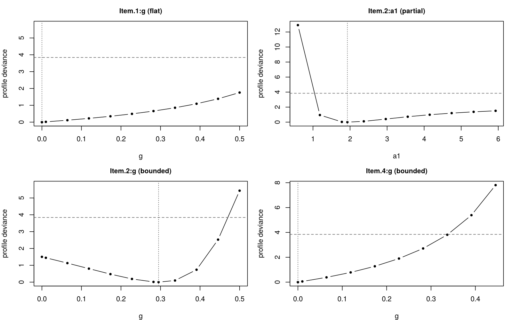
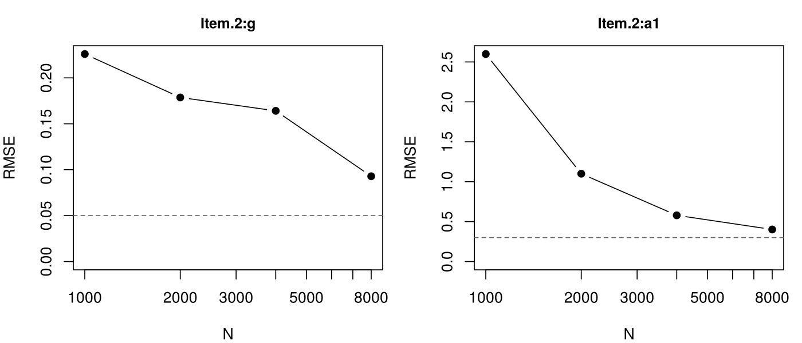

# irtident

<!-- badges: start -->
[](https://github.com/kimcourage/irtident/actions/workflows/R-CMD-check.yaml)
<!-- badges: end -->

**Practical identification diagnostics for item response models fitted with
[mirt](https://cran.r-project.org/package=mirt).**

A 3PL model can converge, pass the second-order test, and still contain parameters that the data barely determine. mirt reports this as a single number, the condition number of the information matrix. irtident tells you **which** item parameters are weakly identified, **why**, and **what to do**.

## Installation

```r
# install.packages("remotes")
remotes::install_github("USERNAME/irtident", build_vignettes = TRUE)
```

## Example

```r
library(mirt)
library(irtident)

dat <- expand.table(LSAT7)
fit <- mirt(dat, 1, itemtype = "3PL", verbose = FALSE)

set.seed(1)
dx <- id_diagnose(fit)
dx
```

```
irtident identification diagnostics
Model: 3PL, 5 items, N = 1000, logLik = -2658.05, converged: yes
mirt information-matrix condition number: 3.84e+06 (one number for the whole model; the table shows where it comes from)

Items:
  Item.1  3PL  boundary
      g   at bound (0.000), flat profile likelihood
  Item.2  3PL  weak
      a1  profile interval open on one side, large SE
      d   profile interval open on one side, confounded with Item.2:g (VIF 21.5)
      g   profile interval reaches the bound (g = 0.00), confounded with Item.2:d (VIF 23.6)
  Item.3  3PL  boundary
      g   at bound (0.000), flat profile likelihood
  Item.4  3PL  boundary
      g   at bound (0.000)
  Item.5  3PL  boundary
      g   at bound (0.000), flat profile likelihood

Advice:
  Item.1:g: fix g = 0 for this item (2PL), or use a prior on g
  Item.2:a1: slope may be unbounded (near-Guttman item); consider a prior on a1
  Item.2:d: estimate d and Item.2:g jointly with care; a prior on one of them helps
  Item.2:g: the data do not rule out g = 0.00; report the profile interval rather than the Wald interval
  Item.3:g: fix g = 0 for this item (2PL), or use a prior on g
  Item.4:g: fix g = 0 for this item (2PL), or use a prior on g
  Item.5:g: fix g = 0 for this item (2PL), or use a prior on g

Multi-start: 20 starts, 1 equivalent-fit cluster(s), 1 inferior optimum/optima; the original fit is among the best solutions.
```

Four items behave like 2PL items. Item 2's guessing parameter is estimated at 0.30 with a Wald interval of [0.10, 0.61], but its profile likelihood interval is [0.00, 0.47]: the data do not rule out `g = 0`.

```r
plot(dx, params = c("Item.1:g", "Item.2:g", "Item.4:g", "Item.2:a1"))
```



How many respondents would it take to pin down item 2?

```r
set.seed(1)
ss <- id_samplesize(fit, params = c("Item.2:g", "Item.2:a1"),
                    N = c(1000, 2000, 4000, 8000), reps = 20)
plot(ss)
```



Even 8,000 respondents do not bring the RMSE of `g` down to 0.05.

## What it does

| Function | Question it answers | How |
|---|---|---|
| `id_local()` | Why is this parameter imprecise? | Splits each sampling variance into intrinsic information × within-item confounding × between-item confounding; finds weakly identified directions |
| `id_profile()` | Is the confidence interval actually closed? | Profile likelihood by continuation; each side is `closed`, `bound` or `open` (Raue et al., 2009) |
| `id_multistart()` | Is there a ridge or a local optimum? | Random starts, clustering of solutions; equivalent-fit modes vs inferior optima, with reflection removed |
| `id_samplesize()` | How much data would it take? | Simulates from the fitted (or a hypothesised) model and finds the N at which RMSE reaches a target |
| `id_diagnose()` | All of the above, per item | Combines the evidence into `ok` / `weak` / `boundary` / `not identified` with advice |

The variance decomposition in `id_local()` is

$$SE_j^2 = \underbrace{1/I_{jj}}_{\text{intrinsic}} \times VIF^{within}_j \times VIF^{between}_j$$

where the first factor is the variance if all other parameters were known, and the two inflation factors come from not knowing the other parameters of the same item and of the rest of the model. With `SE.type = "Fisher"` it can be evaluated at planned parameter values, before any data are collected.

See `vignette("irtident")` for a walk-through, including why guessing parameters of easy items are hard to identify.

## Scope

This is an early version. It supports unidimensional, single-group models fitted with `mirt::mirt()` with itemtypes `Rasch`, `2PL`, `3PL`, `3PLu`, `4PL` and `graded`, without equality constraints. Multidimensional and multiple-group models are planned.

Refits can be slow for 3PL/4PL models. All diagnostics that refit accept `parallel = TRUE` (via `future.apply`):

```r
future::plan(future::multisession, workers = 4)
dx <- id_diagnose(fit, parallel = TRUE)
```

## References

- Chalmers, R. P. (2012). mirt: A multidimensional item response theory package for the R environment. *Journal of Statistical Software, 48*(6), 1–29.
- Raue, A., Kreutz, C., Maiwald, T., Bachmann, J., Schilling, M., Klingmüller, U., & Timmer, J. (2009). Structural and practical identifiability analysis of partially observed dynamical models by exploiting the profile likelihood. *Bioinformatics, 25*(15), 1923–1929.

## License

MIT
